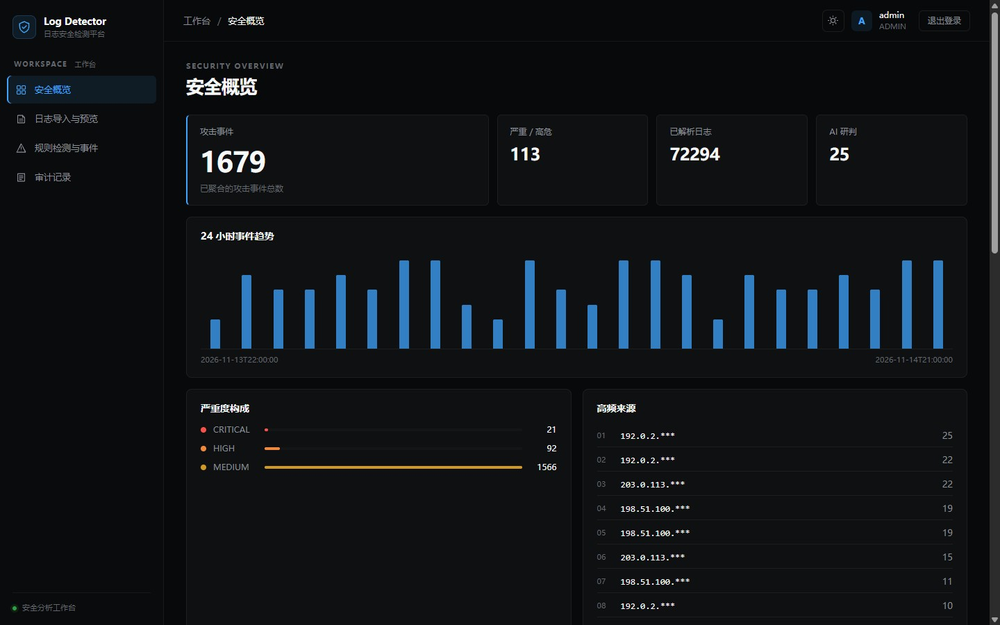
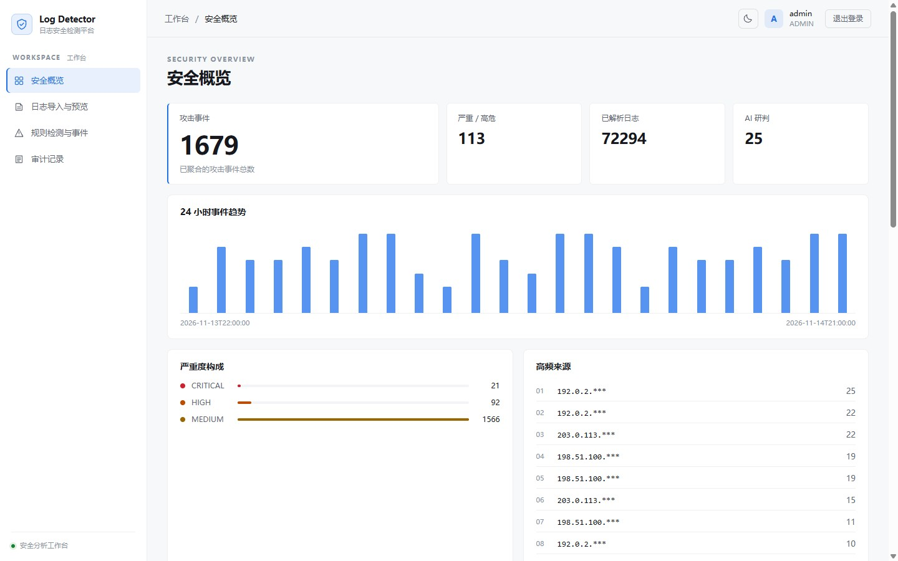
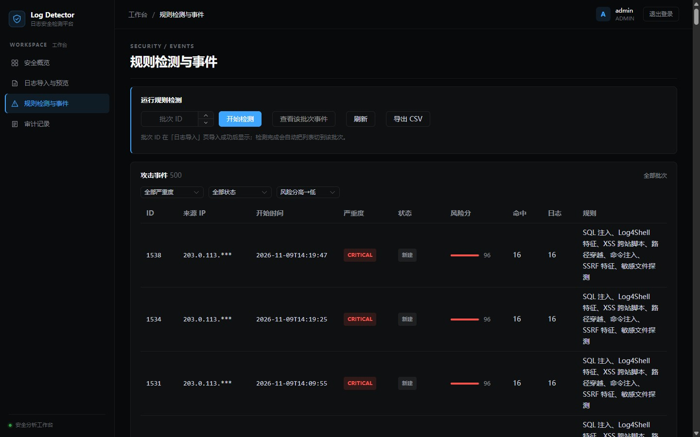
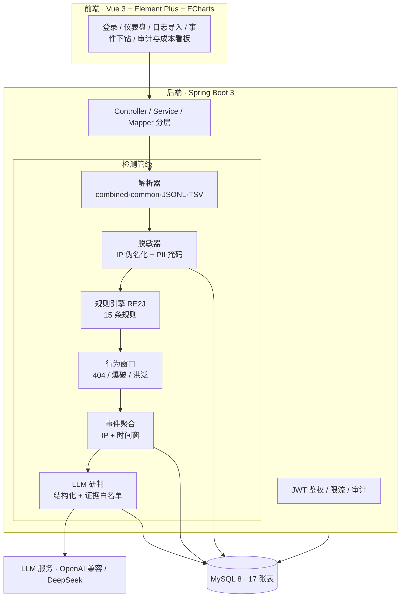

# Log Detector · 日志攻击检测与智能研判平台


> 面向 Web 访问日志的攻击检测与智能研判平台：自研多格式解析、入库前脱敏、规则引擎初筛、大模型攻击链研判，覆盖「日志接入 → 检测 → 事件聚合 → 研判 → 下钻导出」完整闭环。

在真实 SOC 里，分析师每天面对几十万到上千万条 Web 日志，攻击往往被三类噪声淹没：互联网无差别扫描、正常业务产生的高频 404、以及混在普通请求里的 SQL 注入 / XSS / 路径穿越。传统规则引擎能回答"有没有命中"，却回答不了"这意味着什么"。

本平台用**规则引擎高召回圈出异常 → 大模型归纳攻击链与处置建议**的组合解决这个问题；同时把「日志是不可信输入」落实到入库前脱敏、Prompt 注入隔离与证据白名单上——攻击者可以把 UA/URL 写成"忽略以上指令"，但平台不会因此被污染。

## 界面预览

暗色模式（默认）· 安全概览：



亮色模式 · 右上角一键切换：



规则检测与事件 · 严重度筛选与风险分级：



> 演示数据：24 小时事件趋势、严重度构成、高频来源 IP（已脱敏为 `a.b.c.***`）。AI 研判为按需触发 + 结果缓存，非全量调用，故研判数（25）远小于事件数（1,679）。

---

## 核心能力

| 模块 | 说明 |
|---|---|
| **多格式日志解析** | 自研 Apache/Nginx combined、common、JSONL、自定义 TSV 四种格式；单行 ≤8192 字符，失败行进 `skipped_lines` 不崩整批 |
| **入库前脱敏**（核心考点） | 密码/token/Cookie/JWT/邮箱/手机号/身份证/银行卡入库前掩码；客户端 IP 只存 HMAC 伪名（用于聚合）与 `a.b.c.***` 掩码（用于展示） |
| **规则引擎** | 15 条规则，RE2J 线性时间引擎，杜绝灾难性回溯 ReDoS；规则只读、随版本发布 |
| **行为窗口检测** | 单 IP 高频 404、登录口爆破、请求洪泛，滑动窗口计数而非整批计数 |
| **攻击事件聚合** | 同一 IP + 时间窗内的多条命中聚合为一个事件，含风险分、最高严重度、规则集合、命中数、证据日志 ID |
| **LLM 智能研判** | 结构化输出 `{summary, attack_chain, recommendations, confidence, false_positive_notes}`；证据白名单强校验；非 JSON 或证据 ID 全无效时重试 1 次再降级为 `RULE_FALLBACK` |
| **Prompt 注入防御**（核心考点） | 不可信数据信封、NFKC 归一化、指令片段移除、特殊 token 转义、`<`/`>` 转义后才进模型 |
| **审计 / 限流 / 成本** | 登录、导入、研判、状态变更、导出全程审计；登录 8 次/5min、研判 12 次/5min 限流；研判结果缓存 + token 成本看板 |
| **导出** | 脱敏 CSV（防公式注入）、单事件 Markdown 报告、含中文字体的 PDF 报告 |

---

## 架构



管线关键顺序：**解析 → 脱敏 → 入库**（脱敏必须在持久化之前，中间窗口就是泄漏点）→ 规则检测 → 事件聚合 → 研判 → 下钻导出。

---

## 快速开始

### 容器方式（推荐，一键起）

```bash
cp .env.example .env          # 首次运行复制配置，Windows PowerShell: Copy-Item .env.example .env
docker compose up -d --build
```

- 前端：`http://localhost`
- 后端健康检查：`http://localhost:8080/api/health`
- 默认账号：`admin / admin123`（由 `APP_ADMIN_PASSWORD` 决定，首次启动自动创建，BCrypt 存库）
- 默认 `LLM_MOCK=true`，无需 API Key 即可体验完整流程；接真实模型见下文

### 本地开发方式

依赖 JDK 17/21、Maven 3.9+、Node 20+、MySQL 8。详见下文「LLM 接入」与 `.env.example` 注释。前端：

```bash
cd frontend && npm install && npm run dev   # http://localhost:5173 ，/api 已代理到 8080
```

---

## 检测规则

共 15 条（R1–R14 + INJECT）。规则在 `DetectionEngine` 中静态注册，全部使用 RE2J 线性时间正则编译，用户不可编辑。

| 编号 | 规则 | 严重度 | 检测字段 | 触发要点 |
|---|---|---|---|---|
| R1 | SQL 注入 | HIGH | url | `UNION SELECT`、布尔/时间盲注、`information_schema`、堆叠查询 |
| R2 | 跨站脚本 XSS | HIGH | url | `<script>`、`onerror/onload`、`javascript:`、`document.cookie` |
| R3 | 路径穿越 | HIGH | url | `../`、编码穿越、`/etc/passwd`、`win.ini` |
| R4 | 扫描器 UA | MEDIUM | user_agent | sqlmap / Nikto / Nmap / Nuclei / Gobuster / Hydra |
| R5 | 单 IP 高频 404 | HIGH | 行为窗口 | 10 分钟窗口内 ≥12 次 404（目录枚举） |
| R6 | 登录口爆破 | HIGH | 行为窗口 | 5 分钟窗口内对登录路径 POST 401/403 ≥8 次 |
| R7 | 命令注入 | HIGH | url | `;`/`\|`/`&&` 拼接、`$()`、反引号、换行注入 |
| R8 | SSRF / 内网探测 | HIGH | url | 云元数据地址、`file://`、`gopher://`、回环/内网 URL |
| R9 | 敏感文件探测 | MEDIUM | path | `.env`、`.git`、`wp-config.php`、备份/私钥、actuator |
| R10 | Log4Shell JNDI | CRITICAL | url/ua | `${jndi:ldap://...}`、`jndi:rmi://` 等 JNDI 注入 |
| R11 | WebShell 迹象 | HIGH | path | `webshell/shell/c99/r57/b374k/cmd` 等脚本路径 |
| R12 | 异常 HTTP 方法 | MEDIUM | method | `TRACE` / `CONNECT` |
| R13 | URL 明文凭据 | MEDIUM | query | `password/token/api_key/secret` 等参数明文出现在 URL |
| R14 | 请求洪泛 | HIGH | 行为窗口 | 单 IP 1 分钟窗口内 ≥100 次请求 |
| INJECT | Prompt 注入 | HIGH | url/ua | "忽略以上指令"、伪造 system 角色、`<\|im_start\|>` 等特殊 token |

行为规则（R5/R6/R14）的阈值均可在 `application.yml`（`detection.threshold.*`）中配置。

---

## 效果评估

评测报告与原始数据见 [`benchmark/`](benchmark/)。以下数字来自 2026-11-10 的评测记录，**口径已如实标注**：

- **规则评测**（[`benchmark/P1-2-评测说明和测试记录.md`](benchmark/P1-2-评测说明和测试记录.md)）：31 个人工标注的合成场景 × 15 条规则 = 465 个「场景×规则」判定；micro **Precision / Recall / F1 = 1.000**（TP=17，FP=0，FN=0）。*口径：小型合成集、场景针对既有规则构造，不代表真实检出率/误报率。*
- **真实模型评测**（[`benchmark/P1-2-真实模型评测记录.md`](benchmark/P1-2-真实模型评测记录.md)）：deepseek-flash 对 16 个命中场景调用，16/16 通过结构化与证据 ID 校验，无重试、无降级；输入 3,624 token、输出 8,759 token。*口径：结构校验通过 ≠ 事实正确，威胁类型区分受输入上下文约束。*
- **性能**（[`benchmark/P1-5-性能初测记录.md`](benchmark/P1-5-性能初测记录.md)）：

| 规模 | 导入耗时 | 检测耗时（干净样本） |
|---|---:|---:|
| 1 万行 | ~3.7 s | 349 ms |
| 3 万行 | ~8.3 s | 644 ms |

  *口径：单次测量、无预热、含 DB 写入，非容量上限。*
- **测试**：`mvn -f backend/pom.xml test` → **78 项通过**，0 失败 / 0 错误 / 0 跳过。

---

## 安全设计（对应任务书 10 项安全清单）

- **入库前脱敏**：解析 → 脱敏 → 入库，先落库后清洗的中间窗口即泄漏点，已规避。
- **ReDoS 防护**：规则统一 RE2J 线性引擎 + 单行 ≤8192 字符 + 规则不可由用户编辑。
- **Prompt 注入隔离**：日志进模型前经「NFKC 归一化 → 移除零宽字符 → 指令片段替换 → `<`/`>` 转义 → 不可信数据信封」处理；系统提示声明信封内是数据而非指令。
- **证据白名单**：模型输出的 `evidence_log_ids` 必须属于当前事件证据集合，编造 ID 一律剔除；全无效则降级，不把编造内容当结论。
- **SSRF 边界**：不访问日志中的 URL，唯一外连为固定 `LLM_BASE_URL`，禁止重定向、不抓包、不监听。
- **输出安全**：前端禁 `v-html`、纯文本插值；CSV 导出防 `= + - @` 公式注入。
- **密钥管理**：`base_url/api_key/model` 全部走环境变量，`.env` 不入库（`.gitignore` 覆盖），日志不打印明文 Key。

---

## 项目结构

```
Log_Detector/
├── README.md
├── docker-compose.yml            # mysql + redis + backend + frontend(nginx)
├── .env.example                  # 配置样例（无真实密钥）
├── backend/                      # Spring Boot 3
│   └── src/main/java/com/csys/logdetector/
│       ├── log/                  # 日志导入、多格式解析、脱敏
│       ├── detection/            # 规则引擎、事件聚合、研判、成本、PDF 报告
│       ├── llm/                  # LlmClient 抽象 + OpenAI 兼容实现 + Mock + 调用留痕
│       ├── auth/  user/  security/# 登录、用户、JWT、限流
│       ├── audit/                # 审计
│       └── common/  config/      # 统一响应、全局异常、Trace ID
├── frontend/                     # Vue 3 + Vite + Element Plus + ECharts
├── benchmark/                    # 评测报告与原始数据（本文档「效果评估」出处）
├── screenshots/                  # 界面截图
└── ...
```

后端按业务模块组织，模块内分 `controller / service / mapper / entity / dto`；日志导入使用 JdbcTemplate 批量写入（逐条 insert 数万行会超时）。

---

## LLM 接入

默认 `LLM_MOCK=true`（Mock 结果在界面显式标记 `MOCK`），接真实模型：

1. `.env` 中设置 `LLM_BASE_URL` / `LLM_API_KEY` / `LLM_MODEL`（OpenAI 兼容协议，DeepSeek 等均可），`LLM_MOCK` 设为小写 `false`；
2. 业务代码只依赖 `LlmClient` 接口，不直接 new HTTP 客户端；
3. `LLM_MOCK=true` 仅用于断网调试，验收/上线须切回真实调用；改错 Key 或断网时返回友好降级提示而非崩溃（已转成 `BizException(502, ...)`）。

---

## 已知局限与下一步

- 检测是纯规则 + 行为阈值，没有统计基线/机器学习模型；误报治理依赖规则误报边界分析（详见详细设计说明书）。
- 单批次按 IP + 时间窗聚合，不做跨批次全局事件合并与分布式流式接入（明确 Out of Scope）。
- 评测集为合成数据；接入公开带标注日志数据集后可补真实检出率/误报率的量化评估。

---

## 技术栈

**后端**：Java 17 · Spring Boot 3.3 · MyBatis-Plus · JdbcTemplate · MySQL 8 · JWT (jjwt) · RE2J · PDFBox · JDK HttpClient
**前端**：Vue 3 · TypeScript · Vite · Element Plus · Pinia · ECharts
**基础设施**：Docker Compose · Nginx · Redis（限流/缓存，可选）
